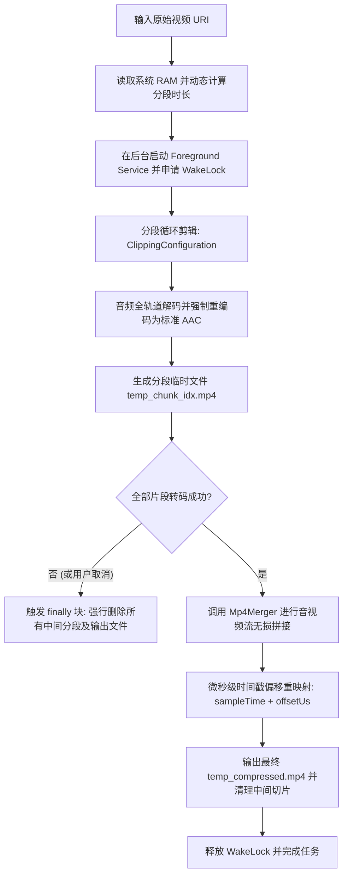

# 安卓长视频分段转码与音视频同步架构文档

本文件详述了 SlimVideo 中针对长视频（特别是经由 `m3u8` 下载合并而成的音视频轨道损坏文件）所设计的**分段转码与音视频硬同步**架构。未来在开发类似的音视频处理模块时，可将本篇作为核心设计规范与开发指南。

---

## 总体架构设计

转码合并的整体流水线采用“**硬件感知分段 -> 精确时间裁剪 -> 独立转码重编码 -> 音视频流时间戳对齐合并 -> 自动清理与状态恢复**”的闭环流程。



---

## 核心技术点解析

### 一、 音频全轨道解码重置 (Audio Re-encoding)

#### 1. 解决的核心问题
* **时间戳断裂与跳变：** `m3u8` 拼接的视频往往在切片交界处存在时间戳不连续，直接合并会导致播放到交界处时音频卡顿、静音或音画不同步。
* **格式兼容性与多声道冲突：** 原始音频流可能是 AC-3、E-AC-3 等移动端系统硬解支持度较低的格式，或者其采样率和声道数在视频中途发生跳变（例如广告切入）。
* **杂音与爆音：** 损坏的 ADTS 头部或未对齐的 AAC 帧会产生极高频的“咔哒”杂音。

#### 2. 实现机制
使用 Jetpack Media3 Transformer 将音频完全解码为**原始无损 PCM 数据**，然后再将 PCM 重编为统一参数的标准 AAC 流：
```kotlin
val transformer = Transformer.Builder(context)
    .setAudioMimeType(MimeTypes.AUDIO_AAC) // 强行重编为标准 AAC
    .setVideoMimeType(mimeType)
    .build()
```
* **解码阶段：** 系统底层的 MediaCodec 解码器吃掉任何带有损坏时间戳的原始音频流，并输出连续的裸音频采样（PCM）。
* **重编码阶段：** AAC 编码器以恒定采样率（例如 44100Hz / 48000Hz）将 PCM 数据打包写入，从而自动生成具有标准 ADTS 头的无损坏音频轨。

---

### 二、 音视频双轨帧精确剪辑对齐 (Frame-Accurate Clipping Sync)

#### 1. 解决的核心问题
* **轨道长度不一致导致的音画漂移：** 如果音频轨道比视频轨道长 50ms，多段拼接后误差会不断累加。在播放到 1 小时后，音频可能滞后数秒。
* **首尾帧空白：** 随意截取时间点会导致视频截取在非关键帧上，从而在分段边缘产生灰屏、绿屏或音频瞬间静音。

#### 2. 实现机制
使用 `MediaItem.ClippingConfiguration` 进行底层时间剪辑：
```kotlin
val mediaItemBuilder = MediaItem.Builder().setUri(sourceUri)
if (isClipped) {
    mediaItemBuilder.setClippingConfiguration(
        MediaItem.ClippingConfiguration.Builder()
            .setStartPositionMs(startMs)
            .setEndPositionMs(endMs)
            .build()
    )
}
```
* **工作原理：** Media3 会解析视频索引，寻找最接近 `startMs` 的前一个关键帧（Keyframe）作为解码起点，同时利用音频的时间戳，在同一时刻把音频 PCM 和视频帧精确截断。这确保了每个转码出来的小片段（`temp_chunk`），其音频轨与视频轨的绝对物理长度是**严丝合缝对齐**的。

---

### 三、 硬件感知动态分段与安全兜底 (Hardware-Aware Dynamic Segmenting)

#### 1. 解决的核心问题
* **低端机 OOM 与显存泄漏：** 安卓硬件编解码器的底册 GPU 显存限制因机而异。如果转码一个超大视频不分段，容易引发底层硬件缓冲区溢出，导致 `Codec failed` 崩溃。
* **高端机转码效率损失：** 分段转码需要频繁重置 MediaCodec 编码器，这在高端旗舰机上是不必要的开销。

#### 2. 实现机制
通过系统内存（RAM）动态调节分段时长：
```kotlin
val activityManager = context.getSystemService(Context.ACTIVITY_SERVICE) as ActivityManager
val memoryInfo = ActivityManager.MemoryInfo()
activityManager.getMemoryInfo(memoryInfo)
val totalRamGb = memoryInfo.totalMem.toDouble() / (1024 * 1024 * 1024)

val segmentDurationMs = when {
    totalRamGb >= 11.0 -> 30 * 60 * 1000L  // 12GB+ 内存设备：30分钟大分段
    totalRamGb >= 7.0 -> 15 * 60 * 1000L   // 8GB 内存设备：15分钟中分段
    else -> 5 * 60 * 1000L                 // 低端设备：5分钟极安全分段
}
```
并且在分段失败时，系统提供了 **OpenGL 渲染退避兜底机制**。一旦首轮因 GPU 显存溢出失败，系统会自动回退至不使用 OpenGL 的 CPU 安全像素拷贝路径。

---

### 四、 无损零重编音视频流拼接与微秒时间戳平移 (Zero-Re-Encode Merging)

#### 1. 解决的核心问题
* **极速无损合并：** 如果对分段后的片段再次进行转码合并，不仅耗时巨大，而且视频画质会发生二次劣化。我们需要在**数毫秒内**完成文件的无损合成。
* **分段接缝处的“硬对齐”：** 必须保证音频和视频的写入时间线完全同步。

#### 2. 实现机制
通过自定义 `Mp4Merger` 封装 `MediaExtractor` 和 `MediaMuxer` 进行解复用与复用，核心在于**时间戳微秒级平移**：
```kotlin
// 平移量 offsetUs = 这一段的物理起始时间毫秒数 * 1000
val offsetUs = segmentStartMs * 1000L

// 循环读取每一段的视频和音频 sample 并进行平移写入
bufferInfo.presentationTimeUs = extractor.sampleTime + offsetUs
bufferInfo.flags = extractor.sampleFlags

muxer.writeSampleData(destTrackIndex, buffer, bufferInfo)
```
* **为什么要加上 `offsetUs`？** 
  因为各个 `temp_chunk` 独立转码后，它们内部样本的 `sampleTime` 都是从 `0` 开始的。通过在写入目标 Muxer 时叠加上该片段在整视频中的起始时间偏移（`offsetUs`），让音视频轨的时间戳在接缝处无缝连续，避免播放器在两段交界处因时间戳归零或回跳导致画面卡死。

---

### 五、 后台任务生命周期与锁安全控制 (Lifecycle & Lock Safety)

#### 1. 解决的核心问题
* **后台 Doze 休眠导致的转码超时：** 安卓息屏后，CPU 会进入深度休眠，导致硬件编解码线程挂起，从而触发 WorkManager 转码看门狗超时。
* **非正常退出的磁盘垃圾堆积：** 当转码中途被用户取消，或者遭遇系统强杀、程序崩溃时，如果不及时清理，GB 级别的临时分段切片将永久残留，严重占用用户手机存储。

#### 2. 实现机制
1. **CPU 锁保护（WakeLock）：** 在 `doWork` 启动时申请 `PARTIAL_WAKE_LOCK`，确保息屏状态下 CPU 依然在正常功耗区间工作：
   ```kotlin
   val powerManager = context.getSystemService(Context.POWER_SERVICE) as PowerManager
   val wakeLock = powerManager.newWakeLock(PowerManager.PARTIAL_WAKE_LOCK, "SlimVideo:TranscodeWakeLock")
   wakeLock.acquire(3 * 60 * 60 * 1000L) // 3小时安全超时保护
   ```
2. **作用域全局化与 `finally` 垃圾强力清理：**
   将 `tempOutputFile`（最终临时输出）和 `chunkFiles`（分段临时文件列表）的声明提升到最外层。在 `finally` 块中，通过引入 `isCompletedSuccessfully` 状态标识。一旦任务以非成功状态（如被主动取消、抛出异常、崩溃）退出，**立刻执行物理删除**：
   ```kotlin
   var isCompletedSuccessfully = false
   try {
       // 执行转码...
       isCompletedSuccessfully = true
   } finally {
       if (!isCompletedSuccessfully) {
           tempOutputFile.delete()
           chunkFiles.forEach { it.delete() }
       }
       if (wakeLock.isHeld) wakeLock.release()
   }
   ```
3. **取消机制绑定：** 用户点击 UI 取消按钮时，调用 `workManager.cancelWorkById(workId)`。这会在底层发送取消信号，直接终止当前 Worker 的协程上下文，进而安全走入 `finally` 清理模块，达到“即取消即腾空间”的效果。
