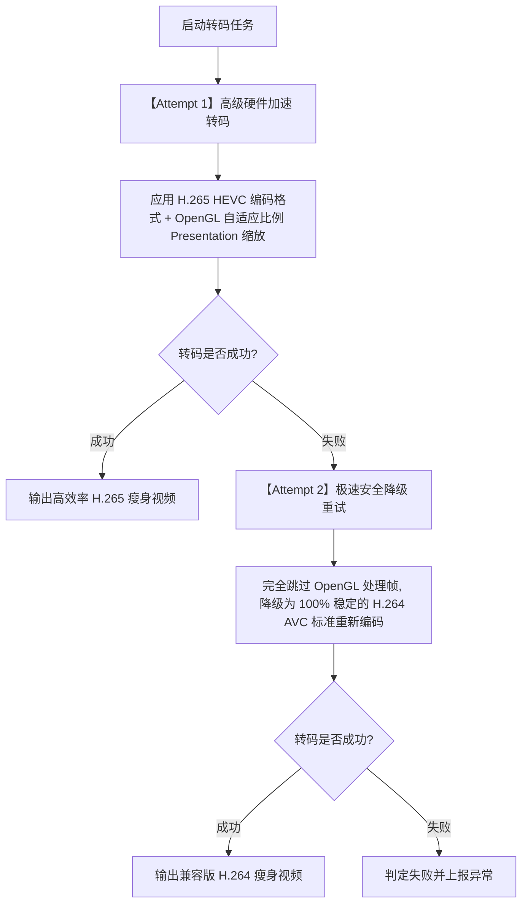

# 🎬 视频转码模块设计与无黑边自适应算法解析

视频压缩与转码是《SlimVideo / 胶卷瘦身》的核心模块。由于大视频转码具有耗电高、耗时长、硬件兼容性复杂的特点，本项目基于 Android Jetpack `WorkManager` 以及 Google `Media3 Transformer` 打造了一套高保活、硬件加速的智能自适应转码引擎。

本文档将详细解密该模块的技术选型、硬件加速降级兜底逻辑、全分辨率自适应等比拟合无黑边算法以及后台保活等关键技术点。

---

## 一、 技术选型与核心组件

为了在移动端实现高效的视频压缩，我们对当前主流的技术路线进行了对比评估：

| 维度 | FFmpeg 软解转码（传统路线） | MediaCodec 芯片硬转码（本项目路线） |
| :--- | :--- | :--- |
| **CPU 负载** | 极高（全核满载跑，极易发热卡死） | **极低**（主要由独立硬件 ASIC 芯片负责） |
| **转码耗时** | 极慢（软解处理 4K/1080p 视频极其痛苦） | **极快**（数倍于实时速度，秒级导出） |
| **电池消耗** | 灾难级（耗电极快，发热严重） | **轻微**（温控良好，耗电量低） |
| **集成体积** | 极大（FFmpeg 动态库通常增加 30MB+ 体积）| **极小**（利用系统内置编解码接口，体积仅数百KB） |

### 1.1 核心选型：Media3 Transformer + MediaCodec 硬编解
本项目全面拥抱谷歌最新的 **Android Media3 Transformer** 库，底层桥接手机内置的 **MediaCodec** 编解码芯片。
* **默认标准**：全面启用下一代高效率视频编码标准 **H.265 (HEVC)** 作为转码容器。相比 H.264，在同等画质下能额外节省高达 50%~60% 的体积。
* **安全兜底**：自动检测硬件能力，若遇到极少数老旧机型不支持 HEVC 硬件编码，系统将智能向下降级为 **H.264 (AVC)** 进行硬件重组，确保 100% 运行稳定性。

---

## 二、 智能压缩预设档位

程序针对不同场景设计了 4 大情景化标签预设，以取代晦涩难懂的技术指标：

1. **🎬 日常高清档 (DAILY_HD)**
   * *设计初衷*：手机保存视频的性价比之王，肉眼难辨画质损耗。
   * *规格*：H.265 / 1080P / 30fps，视频目标码率 **4.5 Mbps**，体积缩减约 80%。
2. **📦 极致省空间档 (EXTREME_SPACE)**
   * *设计初衷*：空间拯救者，针对网课、长视频录屏优化，每分钟仅需约 15MB。
   * *规格*：H.265 / 1080P / 30fps，视频目标码率 **2.0 Mbps**，体积缩减约 90%。
3. **标清便携档 (STANDARD_PORTABLE)**
   * *设计初衷*：手机记录仪或生活随笔备份，追求极小体积。
   * *规格*：H.265 / 720P / 25fps，视频目标码率 **1.2 Mbps**。
4. **💾 极限留存档 (LIMIT_PRESERVE)**
   * *设计初衷*：备份兜底，旨在“能看清发生了什么就行”。
   * *规格*：H.265 / 480P / 24fps，视频目标码率 **0.6 Mbps**。

---

## 三、 全分辨率等比缩放拟合算法（完美消除黑边）

### 3.1 传统转码的黑边痛点
传统转码如果写死目标分辨率为 `1920x1080`（16:9 比例），当遇到以下视频时，Media3 默认会强制渲染出令人难以接受的黑色占位边框（Letterboxing 或 Pillarboxing）：
* 手机竖屏拍摄的视频（如 `1080x1920` 9:16）
* 经典老式视频（如 `1440x1080` 4:3）
* 社交网络常见的正方形视频（如 `1080x1080` 1:1）
* 电影级长画幅视频（如 `3840x1600` 21:9）

### 3.2 动态比例边界拟合算法
我们在 [VideoCompressionWorker.kt](../app/src/main/java/com/example/slimvideo/worker/VideoCompressionWorker.kt) 中引入了**等比边界拟合算法 (Dynamic Proportional Box Fitting)**：

1. **解析物理显示宽高**：首先通过视频元数据和旋转角，还原出真正的物理显示宽高 `originalDisplayWidth` 和 `originalDisplayHeight`。
2. **锚定最大尺寸上限**：以预设中最大的维度（日常高清档为 1920）作为转码 bounding box 的最大上限 `targetMax`。
3. **等比例缩放因子计算**：
   * 如果原图最大维度 `originalMax` 大于上限，我们计算比例因子缩放。
   * **防止低画质反向膨胀**：如果原图最大维度本身就小于上限（如 720p 视频选日常高清档），为了防止无效插值导致画质变差且体积反向膨胀，我们锁定缩放比为 `1.0`（保持原尺寸转码！）。
4. **硬件兼容奇偶化整**：移动端硬件编码器强制要求 Width & Height 必须为**偶数**，算法自动实现奇数向上修正。

```kotlin
val targetMax = maxOf(preset.targetWidth, preset.targetHeight).toDouble()
val originalMax = maxOf(originalDisplayWidth, originalDisplayHeight).toDouble()

// 只有在原片大于目标档位上限时才进行等比缩小
val scale = if (originalMax > targetMax && originalMax > 0) {
    targetMax / originalMax
} else {
    1.0
}

var finalWidth = if (originalDisplayWidth > 0) {
    Math.round(originalDisplayWidth * scale).toInt()
} else {
    preset.targetWidth
}
var finalHeight = if (originalDisplayHeight > 0) {
    Math.round(originalDisplayHeight * scale).toInt()
} else {
    preset.targetHeight
}

// 偶数维度强制化整，防硬件编码器报错崩溃
if (finalWidth % 2 != 0) finalWidth += 1
if (finalHeight % 2 != 0) finalHeight += 1
```

把计算出的 `finalWidth` 和 `finalHeight` 传入 `Presentation.createForWidthAndHeight(...)` 中，这样无论用户导入什么奇特长宽比的视频，转码容器都会**完美等比例拟合，绝对不会产生任何黑边**！

---

## 四、 双轨安全自适应降级体系

在 Android 生态中，由于硬件模拟器、低端芯片或厂商魔改驱动的存在，OpenGL 渲染上下文可能会初始化失败，导致 Media3 抛出 `ExportException` 崩溃。

为了让 App 达到工业级的绝对稳定性，我们设计了**“双轨安全自适应降级重试机制”**：



这种容错设计确保了即使在显卡驱动残缺的云手机、模拟器上，App 也能通过降级 H.264 稳定产出压缩视频，永不闪退。

---

## 五、 后台保活：WorkManager 前台任务规范

大型视频转码可能持续数分钟。为防止用户锁屏或切回微信时系统将 App 静默杀死，本项目在 `VideoCompressionWorker` 中实现了严格的前台通知机制：
1. **立即提升优先级**：在 `doWork()` 最开始调用 `setForeground(...)`，将后台 Work 提升为前台服务（Foreground Service）。
2. **Android 14 (API 34+) 适配**：必须在 `ForegroundInfo` 中声明媒体处理服务类型 `FOREGROUND_SERVICE_TYPE_MEDIA_PROCESSING`，并在 `AndroidManifest.xml` 中配置相应权限，否则在现代高版本系统上运行会直接遭遇 SecurityException 崩溃。

```kotlin
private fun createForegroundInfo(progress: Int, content: String): ForegroundInfo {
    val builder = NotificationCompat.Builder(context, SlimVideoApp.CHANNEL_ID)
        ...
        .setProgress(100, progress, progress == 0)

    return if (Build.VERSION.SDK_INT >= Build.VERSION_CODES.Q) {
        ForegroundInfo(
            NOTIFICATION_ID, 
            builder.build(), 
            android.content.pm.ServiceInfo.FOREGROUND_SERVICE_TYPE_MEDIA_PROCESSING
        )
    } else {
        ForegroundInfo(NOTIFICATION_ID, builder.build())
    }
}
```

---

## 六、 给开发者的采坑与调试建议

1. **OpenGL 环境缺失报错**：如果遇到 `Transformer.Listener` 返回 `ERROR_CODE_DECODING_FORMAT_UNSUPPORTED` 或图形渲染崩溃，优先检查 Attempt 2 的无 Effects 降级链路是否被触发。
2. **视频无法在某些电视/旧播放器播放**：H.265 虽然极其高效，但某些十年前的老电视或极个别旧机型可能只支持 H.264。如果用户有极强的老旧设备兼容需求，可以在主界面配置切换为“经典兼容格式（H.264）”。
3. **后台转码突然中止**：如果高版本系统上后台被中断，请检查手机系统的“电池优化设置”，建议将《胶卷瘦身》设为“无限制以允许后台自启动”。
